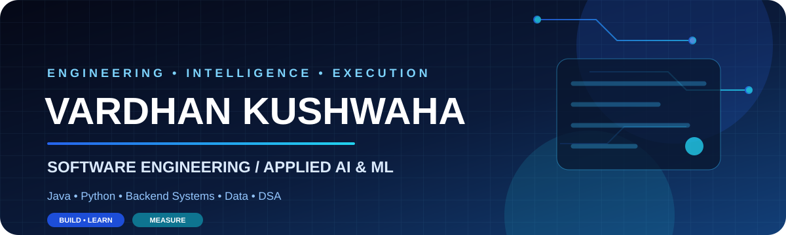
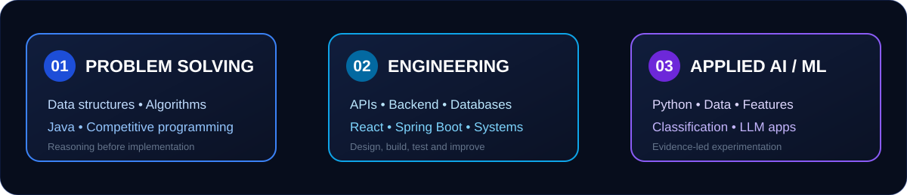
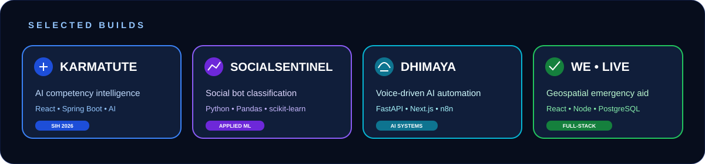
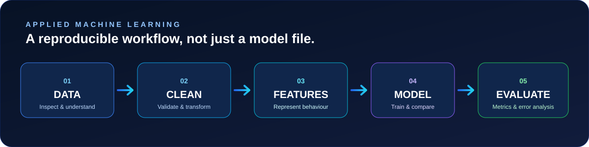

<div align="center">



[](https://github.com/VardhanVersion2)
[](https://vk-29.vercel.app)
[](https://codeforces.com/profile/VardhanK)
[](https://github.com/VardhanVersion2?tab=repositories)

**Computer Science Undergraduate · Software Engineering · Applied AI & Machine Learning**

*I enjoy turning complex problems into useful, testable software — from algorithms and backend systems to data-driven applications.*

</div>

---

## About

I'm **Vardhan Kushwaha**, a B.Tech Computer Science student (2029 batch), interested in the intersection of **software engineering, problem solving and applied AI/ML**.

My work and learning currently revolve around three connected areas:

- **Problem solving:** Data structures, algorithms, Java and competitive programming. I focus on understanding patterns, invariants and trade-offs rather than memorising solutions.
- **Software engineering:** Backend development, REST APIs, databases, full-stack applications, integration and maintainable project structure.
- **Applied AI/ML:** Dataset exploration, preprocessing, feature engineering, classification workflows, model evaluation and practical LLM-powered applications.

> **My engineering loop:** Understand the problem → design the system → build a working version → test its limits → improve with evidence.

## My technical focus

<div align="center">

</div>

| Focus | Current direction |
|:--|:--|
| **DSA & problem solving** | Arrays, hashing, two pointers, sliding window, binary search, trees, graphs and dynamic programming. |
| **Backend engineering** | Java, Spring Boot, REST APIs, databases, authentication and service integration. |
| **Applied AI / ML** | Python, data analysis, feature engineering, classification, evaluation and LLM integration. |
| **Product development** | React-based interfaces, full-stack integration, deployment and practical user workflows. |

## Technical toolkit

> These are technologies used across my repositories and current learning. This list does not imply expert-level proficiency in every tool.

| Area | Technologies |
|:--|:--|
| **Languages** | `Java` `Python` `C` `C++` `JavaScript` `TypeScript` |
| **Frontend** | `HTML5` `CSS3` `React` `Next.js` `Vite` `Tailwind CSS` |
| **Backend & APIs** | `Spring Boot` `Node.js` `Express` `FastAPI` `REST APIs` |
| **AI / ML & Data** | `NumPy` `Pandas` `scikit-learn` `Matplotlib` `Seaborn` `Jupyter` `LLM Integration` `Gemini API` |
| **Databases** | `PostgreSQL` `MySQL` `MongoDB` |
| **Tools & Platforms** | `Git` `GitHub` `Docker` `Linux` `Vercel` `Railway` `n8n` |

---

## Featured projects

<div align="center">

</div>

### 1. KarmaTute — AI Competency & Assessment Platform

**An AI-enabled competency-gap and personalised learning platform** developed for Smart India Hackathon problem statement 26101.

- **Contribution:** Team Lead; system architecture and problem framing for Team INDIEFORGE.
- **Product idea:** Connect competency gaps with targeted assessments, AI-assisted guidance and learning actions.
- **Technology:** React, Vite, Tailwind CSS, Java 17, Spring Boot, REST APIs and Docker Compose.

[Repository](https://github.com/VardhanVersion2/KarmaTute-AI-Competency-Based-Platform-for-Officials-PS26101) · [Live project](https://karma-tute-ai-competency-based-plat.vercel.app)

### 2. SocialSentinel AI — Social Bot Detection

**An applied machine-learning project** exploring behavioural signals to distinguish automated social-media accounts from human users using labelled data.

- **Dataset direction:** Cresci-2017.
- **Workflow:** Dataset inspection → cleaning → behavioural feature engineering → model training → evaluation and error analysis.
- **Technology:** Python, Pandas, NumPy, scikit-learn, Matplotlib and Seaborn.
- **Status:** Work in progress. Performance metrics will be published only after reproducible evaluation.

[ML benchmark repository](https://github.com/VardhanVersion2/Sentinal-AI-Applied-ML-Bot-Detection-Classification-Benchmark) · [Data analysis repository](https://github.com/VardhanVersion2/Social-Sentinal-Data-Analysis-Cleaning-) · [Dataset source](https://botometer.osome.iu.edu/bot-repository/)

### 3. DHIMAYA — Voice-Driven AI Automation

An AI automation project concept connecting natural-language voice input with reasoning and workflow execution.

- **Focus:** Intent understanding, structured execution payloads, tool integrations and workflow orchestration.
- **Technology:** Python, FastAPI, Next.js and n8n.

[Repository](https://github.com/VardhanVersion2/DHIMAYA---COMBINED-AI-AUTOMATION-TOOL-)

### 4. We — Live Happening & Aid

A geospatial emergency-awareness and mutual-aid application focused on incident reporting, location-based awareness and coordination of support.

- **Focus:** Incident reporting, crisis maps, aid discovery and responder workflows.
- **Technology:** React, TypeScript, Node.js, PostgreSQL and Gemini API.

[Repository](https://github.com/VardhanVersion2/We---Live-Happening-and-Aid)

### 5. VK-29 — Personal Engineering Portfolio

My personal portfolio for presenting projects, technical interests and engineering work, including an AI-powered portfolio assistant.

- **Technology:** Next.js, TypeScript and Gemini integration.

[Repository](https://github.com/VardhanVersion2/VK-29) · [Live portfolio](https://vk-29.vercel.app)

### 6. Authora — Library Management Backend

A Java backend project for library operations, structured around a layered Controller–Service–Repository architecture.

- **Technology:** Java, Spring Boot, Spring Data JPA and Maven.
- **Database options in project documentation:** PostgreSQL / MySQL, with H2 for local testing.

[Repository](https://github.com/VardhanVersion2/Authora-Library-management-system)

### More projects & practice

| Project | Area | Link |
|:--|:--|:--|
| **PutzenHire** | TypeScript application | [Repository](https://github.com/VardhanVersion2/PutzenHire) |
| **Campus Saarthi** | Teacher / admin dashboard | [Repository](https://github.com/VardhanVersion2/Campus-Saarthi---Teacher-DsshBoard) |
| **K-Yogi** | Web application | [Repository](https://github.com/VardhanVersion2/KYogi-) · [Live](https://k-yogi.vercel.app) |
| **Attendance Tracker & Analyzer** | Attendance analysis tool | [Repository](https://github.com/VardhanVersion2/Attendance-Tracker-and-Analyzer) · [Live](https://attenguide.netlify.app/) |
| **LeetCode Solved Problems** | Java DSA practice | [Repository](https://github.com/VardhanVersion2/LeetCode-Solved-Problems) |
| **NeetCode Submissions** | Interview problem practice | [Repository](https://github.com/VardhanVersion2/neetcode-submissions) |
| **Hall of PRs** | Open-source contribution practice | [Repository](https://github.com/VardhanVersion2/Hall-of-PRs-Vardhan-Kushwaha) |

---

## Applied AI / ML — how I approach a problem

I want to understand the full machine-learning lifecycle, not just call a model's `fit()` method.

<div align="center">

</div>

| Stage | Questions I want to answer |
|:--|:--|
| **Data understanding** | What does each row represent? What are the labels, schema and data-quality issues? |
| **Preprocessing** | How should missing values, duplicates, inconsistent types and class imbalance be handled? |
| **Feature engineering** | Which measurable signals represent the behaviour we want to model? |
| **Training** | What is a simple baseline? How do we prevent data leakage? |
| **Evaluation** | What do precision, recall, F1-score and the confusion matrix reveal? |
| **Error analysis** | Which examples fail, why do they fail, and what limitations remain? |

**Current interests:** Behavioural classification, data-centric ML, model evaluation, practical LLM applications and AI-powered developer tools.

---

## Problem solving & competitive programming

I practise DSA with an emphasis on recognising reusable patterns and explaining the reasoning behind an approach.

<div align="center">

[](https://codeforces.com/profile/VardhanK)
[](https://github.com/VardhanVersion2/LeetCode-Solved-Problems)
[](https://github.com/VardhanVersion2/neetcode-submissions)

</div>

**Patterns I work with:**

`Arrays & Strings` · `Hashing` · `Two Pointers` · `Sliding Window` · `Binary Search` · `Greedy` · `Stacks & Queues` · `Trees & Graphs` · `BFS / DFS` · `Dynamic Programming`

```text
OBSERVE THE CONSTRAINTS
          ↓
FIND THE INVARIANT
          ↓
CHOOSE THE DATA STRUCTURE
          ↓
DESIGN THE ALGORITHM
          ↓
DRY-RUN EDGE CASES
          ↓
IMPLEMENT & TEST
          ↓
ANALYSE TIME / SPACE
```

## Programs & community

- **Smart India Hackathon · PS26101:** Team Lead for Team INDIEFORGE, working on KarmaTute; focused on system architecture and problem framing.
- **GirlScript Summer of Code:** Selected participant.

## What I'm building towards

- **Strong CS fundamentals:** Data structures, algorithms, operating systems, databases and computer networks.
- **Reliable software systems:** Clean APIs, persistence, testing, security and deployment.
- **Applied AI/ML capability:** Data-centric experimentation, model evaluation and practical AI integration.
- **Useful products:** Software that addresses a real need and can be demonstrated, tested and maintained.

## Connect

<div align="center">

[](https://github.com/VardhanVersion2)
[](https://vk-29.vercel.app)
[](https://codeforces.com/profile/VardhanK)

</div>

<div align="center">

</div>
